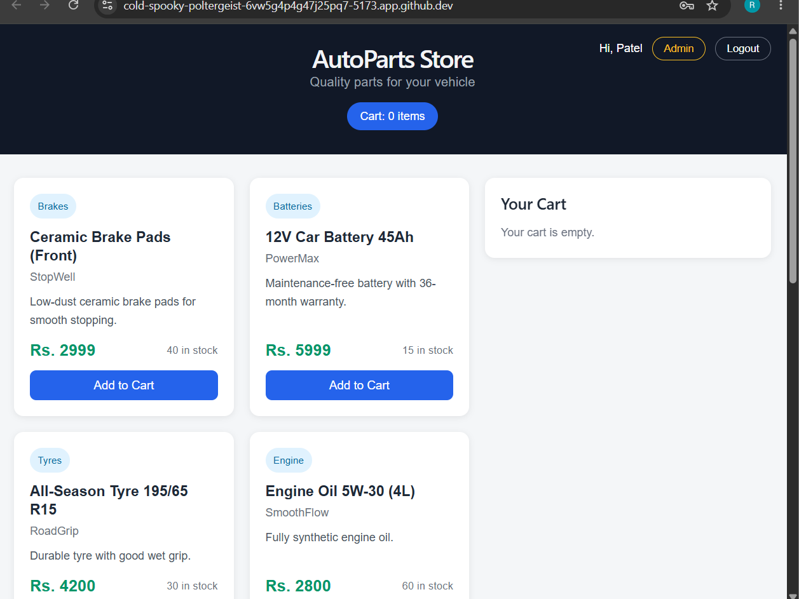
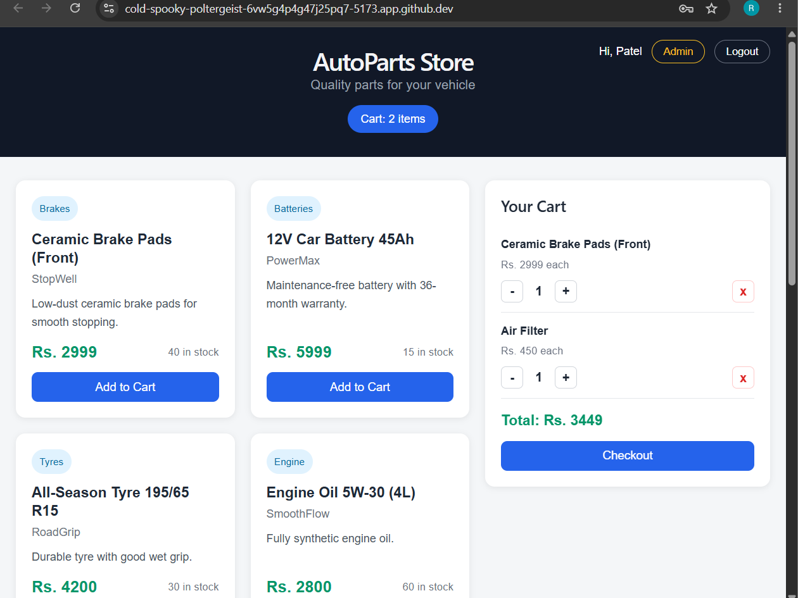
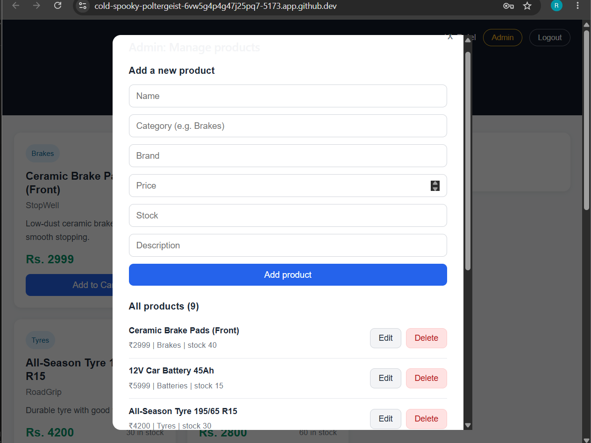

# AutoParts E-Commerce

A full stack e-commerce web application for selling automotive parts, built as an internship project at **UCT**.

**Author:** Patel Riya
**Internship domain:** Full Stack Development
**Tech stack:** React, Node.js, Express, MongoDB

---

## 1. About the Company

UCT is the company where this internship was completed. UCT (UniConverge Technologies Pvt. Ltd.) is an IoT solutions company. Its team brings together professionals from areas such as data analytics, cloud computing, system modelling and distributed architectures, with a vision built around unified and converged technologies. This internship was completed in collaboration with upSkill Campus, where interns work on industry-style projects and submit code and a project report on GitHub.

## 2. Background of the Project

Online shopping has become the normal way to buy products, including vehicle spare parts. Customers want to browse parts by category, check price and availability, and order from home. This project builds a working online store for automotive parts such as brake pads, batteries, tyres, engine oil, lights and tools.

## 3. Problem Statement and Relevance

Buying car parts from local shops is slow. Customers have to visit several shops to compare prices and check stock, and shop owners have no easy way to show their full catalogue or manage orders.

This project solves that with a website where:
- Customers can browse parts, add them to a cart, create an account and place orders.
- The store owner can add, edit and delete products from an admin panel, and stock updates automatically when orders are placed.

It is relevant to industry because e-commerce is one of the most common real-world uses of full stack development, covering a frontend, a backend API, a database, authentication and role-based access.

---

## 4. Design

### 4.1 System architecture

The application has three layers:

```
React frontend (Vite)  -->  Express REST API (Node.js)  -->  MongoDB Atlas
   port 5173                    port 5000                    cloud database
```

- **Frontend:** a single-page React app. It shows products, the cart, login and register forms, checkout and the admin panel.
- **Backend:** a Node.js and Express REST API. It handles authentication, products and orders.
- **Database:** MongoDB Atlas (free tier), accessed through Mongoose.

During development the Vite dev server forwards every request starting with `/api` to the backend, so the frontend and backend can run side by side.

### 4.2 Database design

| Collection | Main fields |
|---|---|
| **Product** | name, description, price, category, brand, stock, image |
| **User** | name, email (unique), password (hashed), isAdmin |
| **Order** | user, items (product, name, price, qty), shippingAddress, totalPrice, paymentMethod, status |

### 4.3 API design

| Method | Endpoint | Access | Purpose |
|---|---|---|---|
| GET | /api/products | Public | List all products |
| POST | /api/products | Admin | Add a product |
| PUT | /api/products/:id | Admin | Edit a product |
| DELETE | /api/products/:id | Admin | Delete a product |
| POST | /api/auth/register | Public | Create an account |
| POST | /api/auth/login | Public | Log in and receive a token |
| POST | /api/orders | Logged-in user | Place an order |
| GET | /api/orders/mine | Logged-in user | View own orders |

### 4.4 Project structure

```
autoparts-ecommerce/
├── backend/
│   ├── middleware/auth.js      (login and admin checks)
│   ├── models/                 (Product, User, Order)
│   ├── routes/                 (productRoutes, authRoutes, orderRoutes)
│   ├── seed.js                 (loads sample products)
│   ├── makeAdmin.js            (promotes a user to admin)
│   └── server.js
└── frontend/
    └── src/
        ├── App.jsx             (store page, cart)
        ├── AuthForm.jsx        (login and register)
        ├── Checkout.jsx        (delivery details and order)
        ├── Admin.jsx           (product management)
        └── App.css
```

---

## 5. Implementation Details

### 5.1 Backend
- Built with **Express**, with **CORS** enabled and JSON body parsing.
- Connects to MongoDB Atlas using **Mongoose**. The connection string and secret key are stored in a `.env` file, which is excluded from GitHub through `.gitignore`.
- A `seed.js` script loads 8 sample products so the store is not empty.

### 5.2 Authentication and security
- Passwords are hashed with **bcrypt** before being stored. Plain passwords are never saved.
- On login, the server issues a **JWT** (JSON Web Token) valid for 7 days. The frontend sends it in the `Authorization` header.
- A `protect` middleware blocks requests without a valid token. An `adminOnly` middleware blocks non-admin users from adding, editing or deleting products.
- The server calculates order prices from the database, not from the browser, so customers cannot fake a lower price.
- The server also checks stock before accepting an order and reduces stock afterwards.

### 5.3 Frontend
- **Product page:** products are fetched from the API and shown as cards with category, brand, price and stock.
- **Cart:** add items, change quantities (limited by stock), remove items, and see the running total.
- **Login and register:** a pop-up form. The token and user are kept in the browser so the user stays logged in after a refresh.
- **Checkout:** logged-in users enter delivery details and place an order. Payment is Cash on Delivery. Guests are asked to log in first.
- **Admin panel:** visible only to admin users. It allows adding, editing and deleting products.

### 5.4 Tools used
React, Vite, Node.js, Express, MongoDB Atlas, Mongoose, bcryptjs, jsonwebtoken, GitHub and GitHub Codespaces.

---

## 6. Results

The final application works end to end:

- **Store page:** products are loaded live from MongoDB and shown as cards with category, brand, price and stock.
- **Cart:** items can be added, changed and removed, and the total updates instantly.
- **Accounts:** customers can register and log in, and stay logged in after refreshing the page.
- **Orders:** logged-in customers can place orders. The order is saved in the database and the product stock goes down automatically.
- **Admin panel:** admins can add, edit and delete products from the website.
- **Security:** passwords are hashed, and only admins can change products.

### Screenshots

**Store page**



**Cart and checkout**



**Admin panel**



---

## 7. Learnings

- I learned how a full stack application fits together: a React frontend, an Express API and a MongoDB database.
- I learned how login works in practice, including password hashing with bcrypt and token-based sessions with JWT.
- I learned to separate normal users from admins and to protect routes on the server instead of only hiding buttons on the page.
- I learned to keep secrets such as the database password in a `.env` file and out of GitHub.
- I learned to use Git and GitHub for saving work step by step, and GitHub Codespaces for developing in the browser.
- I learned to read error messages and fix problems such as wrong folder structure, missing packages and typos in code.

**Challenges faced:** **Challenges faced:** While building the project I faced several real problems and learned from each one. My `.env` and `.gitignore` files ended up in the wrong folder, which caused `node_modules` to be uploaded to GitHub. I fixed it by moving the files and removing `node_modules` from Git tracking with `git rm --cached`. I also hit a "Cannot find module 'express'" error because the packages were not installed in the backend folder, and I solved it by reinstalling them with `npm install`. Later, the React app crashed with a parse error caused by a typo in `App.jsx`, which I fixed by reading the error message and correcting the exact line. The admin button did not appear

**Future improvements:** online payment (Razorpay or Stripe test mode), an order history page, product images, search and filters, and email confirmation for orders.

---

## 8. How to Run the Project

**Requirements:** Node.js, and a free MongoDB Atlas database.

**1. Clone the repository**
```
git clone https://github.com/YOUR-USERNAME/autoparts-ecommerce.git
cd autoparts-ecommerce
```

**2. Set up the backend**
```
cd backend
npm install
```
Create a file named `.env` inside `backend` with:
```
PORT=5000
MONGO_URI=your_mongodb_connection_string
JWT_SECRET=any_long_random_text
```
Load the sample products and start the server:
```
node seed.js
npm run dev
```

**3. Set up the frontend** (in a second terminal)
```
cd frontend
npm install
npm run dev
```
Open `http://localhost:5173` in the browser.

**4. Make an admin account**
Register on the website, then run this inside `backend`:
```
node makeAdmin.js rp0940204@gmail.com
```
Log out and log in again to see the Admin button.